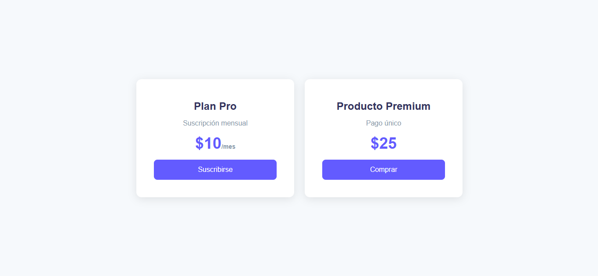
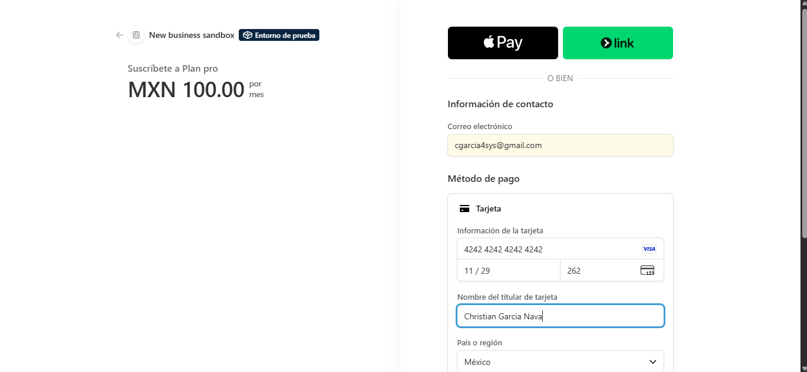
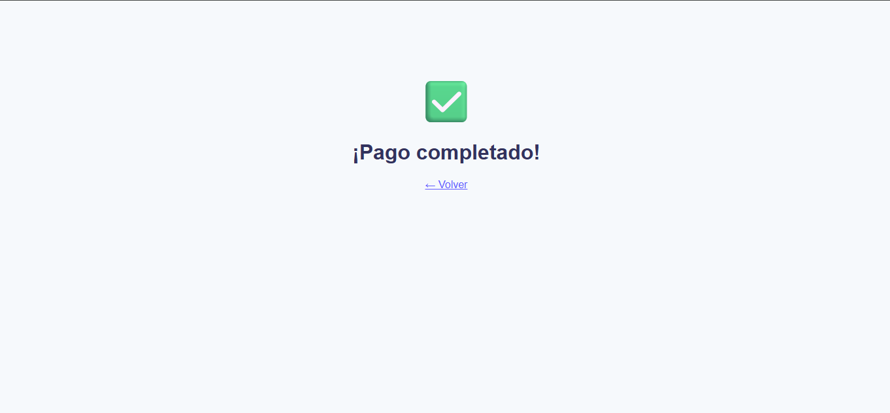
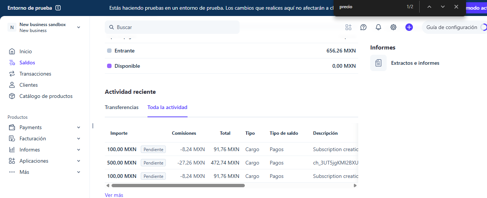

# 💳 Stripe Payments Demo — One-Time + Subscriptions + Webhooks

A working Stripe integration built with **Node.js + Express**, showing the two most requested payment flows: **one-time payments** and **recurring monthly subscriptions**, with **secure webhook handling**.

> 🇲🇽 **En español:** Demo funcional de integración con Stripe en Node.js + Express. Incluye pago único, suscripción mensual recurrente y manejo seguro de webhooks con verificación de firma. Los datos de tarjeta nunca pasan por el servidor.

---

## 📸 Screenshots

| Pricing page | Stripe Checkout |
|---|---|
|  |  |

| Payment success | Stripe Dashboard |
|---|---|
|  |  |

---

## ✨ Features

- **One-time payments** — single charge for a product (`mode: payment`)
- **Recurring subscriptions** — monthly billing handled by Stripe (`mode: subscription`)
- **One endpoint, two flows** — the backend picks the price and mode based on the request
- **Webhook handling with signature verification** — rejects fake or tampered events
- **Events handled:**
  - `checkout.session.completed` — payment or subscription completed
  - `invoice.paid` — monthly renewal charged
  - `invoice.payment_failed` — renewal failed (e.g. card declined)
- **PCI-friendly by design** — card data is entered on Stripe's hosted page and never touches this server
- **Secrets kept out of the code** — all keys live in environment variables

---

## 🔄 How it works

```
User clicks "Subscribe" or "Buy"
        │
        ▼
Frontend → POST /crear-checkout  { tipo: "subscription" | "payment" }
        │
        ▼
Server creates a Stripe Checkout Session (with the secret key)
        │
        ▼
User is redirected to Stripe's secure payment page
        │
        ▼
User pays → Stripe redirects back to /exito.html
        │
        ▼
Stripe sends a signed webhook → server verifies it → confirms the payment ✅
```

**Why the webhook matters:** the redirect to the success page can be faked or skipped by the user. The webhook comes directly from Stripe and is signed, so it is the reliable source of truth for "this payment really happened". That's where you'd activate an account, send an email or update a database.

---

## 🛠️ Tech stack

- **Node.js** + **Express**
- **Stripe Node SDK** (official)
- **dotenv** for environment variables
- Plain HTML + JavaScript frontend

---

## 📂 Project structure

```
stripe-payments-demo/
├── server.js            # Backend: checkout session + webhook
├── public/
│   ├── index.html       # Pricing page (subscription + one-time)
│   ├── exito.html       # Success page
│   └── cancelado.html   # Cancel page
├── docs/                # Screenshots for this README
├── .env.example         # Template for environment variables
├── .gitignore           # Keeps .env and node_modules out of Git
└── package.json
```

---

## 🚀 Run it locally

### 1. Install dependencies
```bash
npm install
```

### 2. Create two products in Stripe (Test mode)
In the Stripe Dashboard → **Products**:
- **Plan Pro** — $10.00 USD, **recurring**, monthly
- **Premium Product** — $25.00 USD, **one-time**

Copy each **Price ID** (starts with `price_`, not `prod_`).

### 3. Set up environment variables
```bash
cp .env.example .env
```
Fill in `.env`:
```env
STRIPE_SECRET_KEY=sk_test_...
STRIPE_PRICE_SUBSCRIPTION=price_...
STRIPE_PRICE_ONETIME=price_...
STRIPE_WEBHOOK_SECRET=whsec_...
PORT=4242
```

### 4. Start the server
```bash
node server.js
```
Open **http://localhost:4242**

### 5. Pay with a test card
| Scenario | Card number |
|---|---|
| ✅ Successful payment | `4242 4242 4242 4242` |
| ❌ Card declined | `4000 0000 0000 0002` |
| 🔐 Requires 3D Secure | `4000 0025 0000 3155` |

Use any future expiry date and any 3-digit CVC.

---

## 🔔 Testing webhooks locally

Stripe can't reach `localhost` directly, so you need a tunnel. Pick one:

**Option A — Stripe CLI**
```bash
stripe listen --forward-to localhost:4242/webhook
```
It prints a `whsec_...` secret → put it in `.env` and restart the server.

**Option B — ngrok**
```bash
ngrok http 4242
```
In Stripe Dashboard → **Developers → Webhooks → Add endpoint**, use `https://<your-ngrok-url>/webhook`, select the three events above, and copy the endpoint's **signing secret** into `.env`.

Once connected, completed payments show up in the server logs:
```
✅ SUSCRIPCIÓN completado. Cliente: cus_...
💰 Renovación mensual cobrada: $10
```

---

## 🔐 Security notes

- The **secret key** is only used on the server and never sent to the browser.
- `.env` is listed in `.gitignore` and is **never committed**.
- Every webhook is verified with `stripe.webhooks.constructEvent()` before it is trusted.
- The webhook route uses `express.raw()` because signature verification needs the original, unparsed request body.

---

## 🧩 Possible extensions

- Save customers and subscriptions to a database (MySQL / PostgreSQL / MongoDB)
- Customer portal so users can cancel or update their card
- Stripe Connect for marketplace payouts with platform fees
- Deploy to Render / Railway with a real webhook endpoint

---

## 👤 Author

**Christian García Nava** — Payment Integration Specialist
Stripe · CyberSource · Card tokenization · Java/Spring Boot · Node.js

💼 Available for payment integration projects on [Upwork](#) <!-- replace # with your Upwork profile URL -->

---

## 📝 License

MIT
